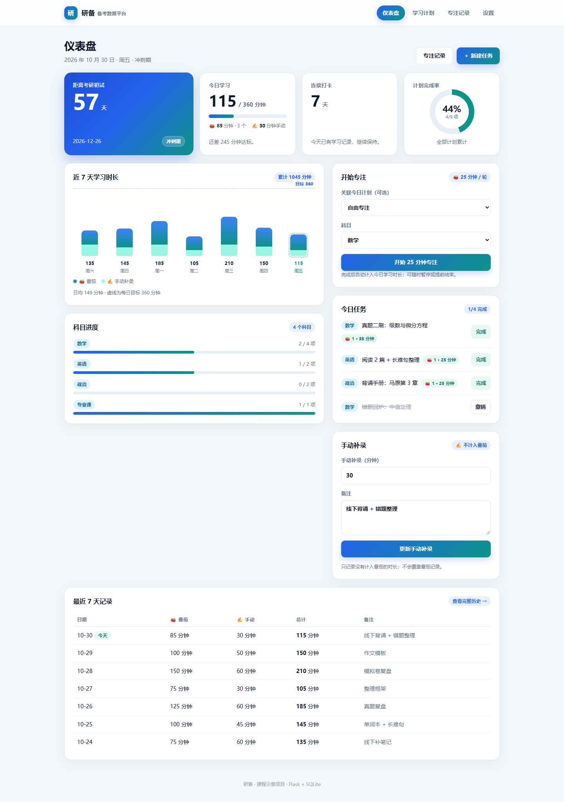
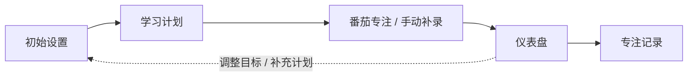

# 研备 · 考研备考任务与数据管理平台

> 用 **Flask + SQLite + 原生 JavaScript** 实现的备考数据看板。  
> 课程示意项目：30 秒完成初始设置，即可体验「计划 → 番茄专注 / 手动补录 → 数据反馈」的完整闭环。



---

## 1. 项目用途

市面上的备考工具通常有两个问题：要么只适配某一类专业（科目写死），要么记录成本太高，用几天就放弃。

「研备」想验证一个更通用的思路：**把考试日期、阶段、每日目标、科目都做成可配置项**，平台不预设你考什么专业、处于什么阶段、是在校还是脱产，只负责把「今天该做什么」和「最近学得怎么样」清楚地展示出来。

当前版本包含一条完整的数据闭环：

- 用**学习计划**拆解任务，按日期管理
- 用**番茄钟**记录专注时间，也可以**手动补录**未计时的学习
- 用**仪表盘**查看倒计时、今日进度、连续打卡、7 天趋势和科目进度
- 用**专注记录**按月回看每一个番茄，历史只读、可追溯

---

## 2. 核心功能

| 模块 | 能力 |
| --- | --- |
| 初始设置 | 考试日期、阶段（基础/强化/冲刺/模考）、每日目标分钟数、科目自由输入 |
| 仪表盘 | 倒计时、今日学习（🍅 番茄 + ✍️ 手动补录）、连续打卡、计划完成率、近 7 天堆叠趋势、科目进度、今日任务、开始专注、手动补录、最近 7 天记录 |
| 番茄钟 | 默认 25 分钟专注 + 5 分钟短休，每 4 个番茄长休 15 分钟；时长可配置；暂停/继续；提前结束按实际分钟记录；结束提示音与标题提示 |
| 计划关联 | 开始专注时可选择今日计划，也可自由专注并选择科目；一个计划可累计多个番茄；完成番茄不自动完成计划 |
| 专注历史 | 按月查看番茄记录和手动补录，显示每次专注的时间段、科目、计划快照与完成状态；历史只读 |
| 学习计划 | 自由科目和任务、按日期规划、待完成/已完成分组、逾期标记、完成/撤销/删除 |
| 手动补录 | 一天一条，用于补充没有开计时器的学习；与番茄分开显示，不会覆盖番茄记录 |
| 演示数据 | 首次启动自动生成一套“以今天为基准”的示例计划、番茄记录和手动补录；设置页可一键重置 |

---

## 3. 番茄钟的设计取舍

### 3.1 今日学习 = 🍅 番茄 + ✍️ 手动补录

番茄记录和手动补录是两种不同来源的数据：

- 番茄：有开始/结束时间，可关联计划，默认一次 25 分钟
- 手动补录：没有计时过程，用于线下背诵、纸质刷题等场景

仪表盘会把两者相加为“今日学习”，但分开显示，并用 ✍️ 标记手动补录的来源。番茄记录**不会被手动补录覆盖**。

### 3.2 计时器在浏览器本地运行

计时状态保存在浏览器 `localStorage`：

- 切换页面、刷新页面后可以恢复
- 关闭浏览器不保证后台继续计时
- 如果关闭期间已超过结束时间，重新打开时会先询问“是否记录为完成”，不会静默记时间
- 同一浏览器同一时间只维护一个计时器；多标签页不做同步

### 3.3 番茄记录只追加

每次完成或提前结束都会写入一条 `pomodoro_sessions`：

- 不提供删除/编辑接口，历史不会被覆盖
- 计划被删除后，历史仍保留任务快照（`plan_task`）和科目
- 提前结束的番茄分钟数照常计入，但状态标记为 `partial`，不计入“完成番茄个数”
- 休息时间不写入记录，也不计入学习时长

### 3.4 计划关联是可选的

- 下拉框默认列出**今天的计划**，也可以选择“自由专注”
- 自由专注时需要选一个科目
- 计划详情会显示累计投入，例如 `🍅 2 · 50 分钟`
- 番茄完成不会自动把计划标记完成，完成状态仍由用户决定

---

## 4. 数据闭环



- 设置决定看板如何计算（倒计时、目标线、科目维度、番茄时长）
- 计划提供「完成率」和「今日任务」
- 番茄与手动补录提供「学习时长」「连续天数」「7 天趋势」
- 看板与历史再把结果反馈给用户，驱动下一步计划

---

## 5. 设计思路

### 5.1 配置驱动，而不是把科目写死

科目、考试日期、阶段、每日目标、番茄时长全部存放在 `settings` 表里。默认科目只是示例，用户可以改成「法硕 / 408 / 333 / 专业课」等任意组合；在学习计划里输入新科目，也会自动补充进科目配置。

### 5.2 先降低记录成本，再谈数据分析

每天只需要两个动作：**开始一个番茄**，或者**手动补录一次时长**。  
番茄钟负责降低计时成本，手动补录负责覆盖没有开计时器的场景，两者共同保证“愿意每天记录”。

### 5.3 示例数据相对“今天”生成

示例计划、番茄和补录都以运行当天为基准生成，因此无论哪天打开，看板都是“活”的：有最近 7 天数据、有今天待办、有逾期/未来任务。

### 5.4 先做深一个核心场景

课程项目时间有限，这一版先把“计时 → 记录 → 看板 → 历史”做完整；错题本、自动计划、多用户、提醒等放到 Roadmap，避免每个功能都只做一半。

---

## 6. 技术栈

- **后端**：Python 3 + Flask（单文件 `app.py`）
- **数据库**：SQLite（Python 内置 `sqlite3`，零配置）
- **模板**：Jinja2
- **前端**：原生 HTML/CSS/JavaScript，无构建工具、无外部 CDN 依赖
- **计时器状态**：浏览器 `localStorage`
- **部署形态**：本地运行，浏览器访问

工程细节：

- 所有 SQL 使用 `?` 参数化查询
- 表单统一 `POST` + `redirect`（PRG），避免刷新重复提交
- 番茄记录通过 `POST /api/pomodoro/sessions` 写入，只追加
- 首次访问强制引导到设置页，完成后进入仪表盘
- 旧版 `checkins.duration_min` 会自动迁移为 `manual_minutes`，历史不丢

---

## 7. 目录结构

```text
code-demo/
├── app.py                  # 后端：路由、数据库、统计、番茄 API、迁移
├── requirements.txt
├── README.md
├── .gitignore
├── docs/
│   ├── dashboard.png       # 看板截图
│   └── DEV_NOTES.md        # 开发交接记录（给后续迭代）
├── static/
│   ├── app.js              # 番茄钟前端逻辑（localStorage + 计时）
│   └── favicon.svg
└── templates/
    ├── base.html           # 公共布局、全局样式、悬浮计时器
    ├── dashboard.html      # 仪表盘 /
    ├── plans.html          # 学习计划 /plans
    ├── settings.html       # 初始设置 / 平台设置 /settings
    └── focus_history.html  # 专注记录 /focus
```

首次运行会自动生成 `kaoyan.db`（已在 `.gitignore` 中忽略）。

---

## 8. 本地运行

```bash
# Windows（本机使用 py 启动器）
py -m pip install -r requirements.txt
py app.py
```

```bash
# macOS / Linux
python3 -m pip install -r requirements.txt
python3 app.py
```

浏览器打开 **http://127.0.0.1:5000**。

首次打开会进入「初始设置」页，表单已预填一套示例配置：

1. 直接点击「保存并进入仪表盘」，即可看到完整示例看板；
2. 也可以先改成自己的考试日期、阶段、每日目标、科目和番茄时长；
3. 首次启动已自动生成示例计划、番茄和手动补录，可在设置页点击「重置示例数据（仅演示）」重新生成。

> 想彻底清空（包括设置）时，停止程序后删除 `kaoyan.db`，再次启动即可重新初始化。

---

## 9. 使用流程

1. 在「设置」里填写目标，保存后进入仪表盘。
2. 在「学习计划」里添加今天的任务，或直接使用示例任务。
3. 回到仪表盘，在「开始专注」里选择今日计划或自由专注，开始一个番茄。
4. 专注结束后会提示是否休息；完成的番茄自动计入今日学习。
5. 没有开计时器的学习，用「手动补录」补充，带 ✍️ 标记。
6. 在「专注记录」里按月查看番茄和补录，历史只读。

---

## 10. 数据模型

| 表 | 字段 | 说明 |
| --- | --- | --- |
| `plans` | `id, subject, task, plan_date, done` | 学习计划；科目为自由文本 |
| `checkins` | `id, check_date, manual_minutes, note` | 每日**手动补录**；`check_date` 唯一 |
| `pomodoro_sessions` | `id, plan_id, plan_task, subject, session_date, started_at, ended_at, duration_min, status, created_at` | 番茄记录；只追加，`plan_task` 为任务快照 |
| `settings` | `key, value` | 考试日期、阶段、每日目标、科目 JSON、番茄时长、初始化状态 |

今日总时长计算：

```text
今日总时长 = SUM(当天 pomodoro_sessions.duration_min) + 当天 checkins.manual_minutes
```

连续打卡：番茄记录或手动补录任一存在的日期，连续计数。

---

## 11. 已自测

- 首次访问重定向到设置页；保存设置后进入看板
- 示例数据数量、连续打卡天数、今日总时长、完成率计算正确
- 番茄 API：完成记录、提前结束、计划快照、非法时长/状态校验
- 手动补录：新增/更新、与番茄相加、历史保留
- 页面显示：🍅/✍️ 拆分、堆叠趋势图、计划投入、最近 7 天记录
- 专注历史：按月查询、完成/未完成状态、手动补录展示
- 设置：番茄时长、长休间隔保存与校验
- 重置示例数据保留用户设置
- 旧库迁移：`checkins.duration_min` → `manual_minutes`，历史不丢
- 浏览器端到端（Edge + Playwright）：开始番茄 → 暂停/继续 → 切换页面恢复 → 自动完成 → 记录入账 → 跳过休息 → 历史页展示

---

## 12. 后续可扩展方向（Roadmap）

1. **专注记录年/月/日三级下钻**：年视图 → 月视图 → 日详情，并加入日历热力图
2. **提醒机制**：每日待办、未完成任务、休息结束（浏览器通知 / 邮件 / 微信）
3. **错题本与间隔复习**：按科目/章节/错因分类，支持图片与公式，遮住答案重做
4. **自动计划生成**：输入考试日期、科目、基础与每日时长，生成可调整的周/日计划
5. **账号与多端同步**：注册登录、多用户数据隔离、云端数据库
6. **院校与科目模板库**：统考科目（408/333/法硕/管综等）与自命题专业课模板
7. **身份化引导**：应届 / 在职 / 脱产 / 二战，不同人群使用不同计划强度
8. **数据导入导出**：CSV / Excel、备份与恢复
9. **移动端 / PWA**：手机上更轻量的计时和打卡体验

---

## 13. 已知限制

本项目是课程示意项目，重点在完整流程和产品思路，不是生产级系统：

- 单用户、无登录、无权限体系
- 未引入 CSRF 防护（本地演示足够，正式部署需补充）
- SQLite 本地文件存储，不适合直接多人并发使用
- 番茄计时状态依赖浏览器本地，不做多端同步；多标签页未做互斥
- 浏览器通知尚未实现；结束提示音可能受浏览器自动播放策略影响
- 专注历史目前按月份查看，年/月/日下钻在下一轮
- 示例数据仅用于演示，不代表真实备考建议

---

## 14. 说明

本项目为课程作业的 vibe coding 示意项目，使用 AI 辅助完成；代码结构、页面流程与 README 设计思路均面向后续继续迭代。

> 更详细的技术状态、决策记录、已知限制与下一轮优先级，见 [`docs/DEV_NOTES.md`](docs/DEV_NOTES.md)。
